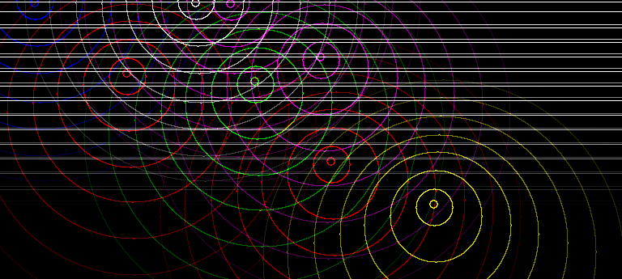

# asyncEn
asyncEn is an open source (GPL2) minimalistic environment for testing AI algorithms that consume events such as spiking neural networks.  
The simulation takes place on a surface and generates waves during collisions and movements.  
This is the simplest environment I could write.  Everything is a circle or a horisontal/vertical line to simplify collision detection.  
Agents driving objects' behavior send momentary actions and receive events from the environment.  
Agent actions are turn left/turn right/kick forward.  Events include collisions and wave interactions.  

  

Circular waves are generated when objects move.  Straight lines propagate out from walls when they get hit. In this case top wall got hit by two entities and straight lines are moving down.  Waves dissipate and faint as they move away from the source.  This should allow agents to determine distances to object that generated the waves.  

Run ```make; make run``` to see how things work.  

# Simulation Goals
The first goal of the simulator is to train agents to avoid collisions in the environment.  Agents will have to learn continuously because at some point (surprise! surprise!) agents will change the speed at which they are traveling.  This should test algorithms for continual learning and an ability to learn within an environment with non-stationary processes.  

# Techical details
Simulation is written in C++.  Before Apr 2025 all code was written by hand.  
The only library dependency is SDL2 which has to be installed before compiling.  

# Agents
Agents are stand alone stdio-style executables.  
See [easya.cpp](agents/easya.cpp) for a complete sample random agent implementation.  
[keypad](agents/keypad.cpp) agent allows you to click on keypad window and use UP/LEFT/RIGHT arrows to move one agent around.  
[bounce](agents/bounce.cpp) agent moves across until it hits a wall or another agent.  
[sound](agents/sound.cpp) agent will play simple chords when waves hit its sensors.  Open wave.html to see an animation of how the wave hits the sensors.  

# Other simulators
I've thought about using [Box2D](https://box2d.org) to simulate physics since it also generates events.  However it seems that shapes are immutable.  You cannot modify their properties like the radius after creation.  Deleting and creating wave objects to check collisions on every frame might be too expensive or even impossible.  

Last updated 11/2026
